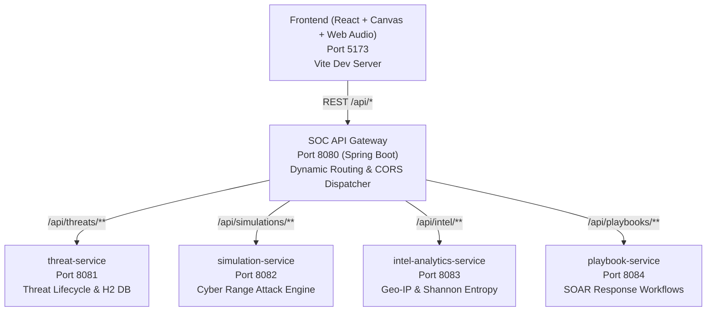

# 🛡️ Network Threat Intelligence Dashboard (Next-Gen SOC & Microservices Suite)
**Drive Link: [Network Threat Intelligence Dashboard](https://drive.google.com/drive/folders/1gvjLy8a5_XjYUSH3ViAJ6B4dG4DJuTq6?usp=sharing)**
A high-class, military-grade Security Operations Center (SOC) web application powered by **Spring Boot Microservices Architecture** and a futuristic **React / Canvas** tactical interface. Security analysts monitor live cyber attacks, simulate volumetric botnet campaigns, inspect raw packet hex payloads with Shannon entropy algorithms, track adversary TTPs on the MITRE ATT&CK Matrix, and execute automated SOAR containment playbooks.

---

## 🚀 Key Features & High-Class Graphics

1. **60 FPS Ballistic Threat Radar & Geo-Map**:
   - Canvas-driven military radar with rotating sweep beams and pulsing acoustic sonar pings.
   - Real-time animated ballistic missile / packet trajectory arcs curving from attacker coordinates (Moscow, Shanghai, Pyongyang, Ashburn, Sao Paulo, Amsterdam, Tehran) into the SOC datacenter with impact shockwave ripples.
2. **Interactive Cyber Range Attack Simulator**:
   - Live attack campaign emulator: Volumetric TCP SYN Flood, LockBit 3.0 Ransomware C2 Beaconing, Log4j RCE (CVE-2021-44228), Nmap Decoy Port Scan, and APT29 Kerberoasting.
   - Botnet swarm slider (up to 25,000 bots), 3x burst traffic injector, live PPS/Mbps counters, and raw packet sniffer console.
3. **Deep Packet Inspection (DPI) & Shannon Entropy Analyzer**:
   - 60 FPS real-time oscilloscope waveform monitor tracking network ingress Mbps and PPS.
   - Raw hex payload disassembly with byte offsets, ASCII decode, TCP flag inspection, and heuristic entropy alerts ($H > 7.4$ bits/byte detects encrypted ransomware / packed shellcode).
4. **MITRE ATT&CK Matrix & Threat Actor Dossiers**:
   - Interactive matrix covering Initial Access, Execution, Credential Access, Discovery, C2, and Impact with real CVE links.
   - Comprehensive threat actor dossiers on APT29 Cozy Bear, Lazarus Group, LockBit Cartel, and Volt Typhoon.
5. **NIST SP 800-61 Automated SOAR Playbooks**:
   - Step-by-step automated containment: BGP /32 blackholing, endpoint memory preservation, Kerberos token revocation, and WAF virtual patching.
6. **Microservices Mesh Topology Visualizer**:
   - Live architectural map showing health status, REST throughput, port assignments, and latency across the 5 Spring Boot microservices.
7. **Synthesized Tactical Audio Engine**:
   - In-browser Web Audio API acoustic sonar pings, dual-tone critical attack klaxons, affirmative mitigation chimes, and button click feedback (zero external audio files required, toggleable).

---

## 🏗️ Spring Boot Microservices Architecture



| Microservice | Port | Primary Job |
|---|---|---|
| **`api-gateway`** | **8080** | Central ingress reverse proxy, dynamic route dispatcher, and mesh health topology. |
| **`threat-service`** | **8081** | Incident lifecycle, H2 database persistence, IPv4 validation, persistent attacker escalation. |
| **`simulation-service`** | **8082** | Cyber range attack engine, botnet swarm traffic generation, live packet log sniffer. |
| **`intel-analytics-service`** | **8083** | Real-time GeoIP coordinates, ballistic trajectory arcs, Shannon Entropy calculation ($H \in [0, 8]$). |
| **`playbook-service`** | **8084** | SOAR automated containment playbooks (BGP null-routing, host memory dump, credential revoke). |

---

## 🚀 One-Click Launch Options

### Option A: Complete Distributed Microservices Suite (Recommended)
Double-click `start-all-microservices.bat` in the project root:
```bat
start-all-microservices.bat
```
Launches the 5 Spring Boot microservices (ports 8080-8084) and the Vite React frontend (port 5173).

### Option B: Fast Monolith Mode
Double-click `start-all.bat` in the project root:
```bat
start-all.bat
```
Launches the consolidated Spring Boot backend on port 8080 and the React frontend on port 5173.

### Option C: Instant Zero-Dependency Frontend
```powershell
cd frontend
npm run dev
```
Open **`http://localhost:5173`**. The intelligent client-side fallback simulation engine will immediately run all 6 modules, radar graphics, and simulations with zero server dependencies required!

---

## 📚 Deep Research Documentation
For comprehensive technical research on cyber attack mechanics, Shannon Entropy, MITRE ATT&CK mappings, and NIST incident response lifecycle, refer to [`MICROSERVICES_RESEARCH.md`](./MICROSERVICES_RESEARCH.md).

---

### Option A: One-Click Startup (Windows)
Double-click `start-all.bat` in the project root:
```bat
start-all.bat
```
This automatically launches both the Spring Boot backend (:8080) and Vite React frontend (:5173) in separate terminal windows.

---

### Option B: Manual Startup

#### 1. Start Spring Boot Backend (Port 8080)
Open a terminal in the root directory:
```powershell
cd backend
# Using the pre-installed Maven wrapper or mvn command:
mvn spring-boot:run
```
- API Base: `http://localhost:8080/api/threats`
- Stats: `http://localhost:8080/api/threats/stats`
- H2 Web Console: `http://localhost:8080/h2-console` (JDBC URL: `jdbc:h2:file:./data/threatsdb`, User: `sa`, Password: blank)

#### 2. Start Vite React Frontend (Port 5173)
Open a second terminal in the root directory:
```powershell
cd frontend
npm install
npm run dev
```
Open your browser at: **`http://localhost:5173`**

---

## 🧪 Typical User Action Walkthrough

1. **Log a Critical Attack**:
   - The analyst enters an IP: `203.0.113.88`
   - Selects Attack Vector: `DDoS Attack`
   - Selects Severity: `Critical`
   - Clicks **Record Incident**
   - **React** sends `POST /api/threats`.
   - **Spring Boot** validates the IPv4 pattern, saves the record with `status: "Active"`, and responds with `201 Created`.
   - **React** reloads the dataset: the new incident appears at the top with a **Red Critical badge**, and the **Active Threats** counter increments.

2. **Mitigate an Incident**:
   - The analyst clicks the **Mitigate** button on an active row.
   - **React** sends `PATCH /api/threats/{id}/mitigate`.
   - **Spring Boot** sets `status = "Mitigated"` in the database.
   - **React** refreshes the feed: the button turns into a green **"✓ Resolved"** badge, the **Active** counter decreases, and the **Mitigated** counter increases.

3. **Verify Bad Input Rejection**:
   - The analyst enters an invalid IP address: `999.1.1.1` (or clicks the *"⚠️ Test Invalid IP (999.1.1.1)"* preset button).
   - Both client-side regex and backend Spring Boot `@Pattern` validation reject the input.
   - The backend returns `400 Bad Request`:
     ```json
     {
       "status": 400,
       "message": "Validation failed for threat incident",
       "errors": {
         "ip": "Invalid IPv4 address format (each octet must be between 0 and 255, e.g., 192.168.1.50)"
       }
     }
     ```
   - The UI displays an inline validation message with error styling.

---

## 📂 Project Directory Structure

```
Network Threat Intelligence Dashboard/
├── backend/
│   ├── pom.xml                               # Spring Boot 3.3.4 dependencies
│   ├── src/
│   │   ├── main/
│   │   │   ├── java/com/threatintel/dashboard/
│   │   │   │   ├── DashboardApplication.java  # Main Spring Boot application class
│   │   │   │   ├── model/
│   │   │   │   │   ├── Threat.java            # JPA Domain Entity 1 (Threat incidents)
│   │   │   │   │   └── SecurityAlert.java     # JPA Domain Entity 2 (SOC alerts & audit log)
│   │   │   │   ├── repository/
│   │   │   │   │   ├── ThreatRepository.java  # Spring Data JPA repository for Threats
│   │   │   │   │   └── SecurityAlertRepository.java # JPA repository for SecurityAlerts
│   │   │   │   ├── service/
│   │   │   │   │   └── ThreatService.java     # Business Layer (Core rules & state machines)
│   │   │   │   ├── controller/
│   │   │   │   │   ├── ThreatController.java  # Presentation Layer (REST API endpoints)
│   │   │   │   │   └── GlobalExceptionHandler.java # REST exception handling & validation
│   │   │   │   ├── dto/ThreatStatsDTO.java    # Stats data transfer object
│   │   │   │   └── config/DataInitializer.java# Database telemetry seed data generator
│   │   │   └── resources/application.properties # Port 8080 & H2 persistence config
│   │   └── test/java/com/threatintel/dashboard/
│   │       ├── ThreatControllerTest.java     # Integration tests (MockMvc + SpringBootTest)
│   │       └── ThreatServiceTest.java        # Unit tests for business rules (JUnit 5 + Mockito)
├── frontend/
│   ├── package.json                          # Vite + React + Lucide dependencies
│   ├── vite.config.js                        # Port 5173 + /api proxy to 8080
│   ├── index.html                            # Semantic HTML + SOC metadata
│   └── src/
│       ├── main.jsx                          # React entry point
│       ├── App.jsx                           # Application state & coordination
│       ├── App.css                           # Cybersecurity control room styles
│       ├── index.css                         # Design system tokens & animations
│       ├── api.js                            # Centralized HTTP client methods
│       └── components/
│           ├── Header.jsx                    # SOC header with live UTC clock
│           ├── StatsCards.jsx                # The 3 counters (Total, Active, Mitigated)
│           ├── ThreatForm.jsx                # Entry form with quick-fill presets
│           ├── SearchBar.jsx                 # Live search and status/severity filters
│           ├── ThreatTable.jsx               # Incident registry with red/orange/yellow/teal badges
│           └── ArchitectureModal.jsx         # Architecture & 5 technologies guide
├── stages_demo/                              # Evolution walkthrough
│   ├── stage1_html_css/index.html            # Stage 1: Static structure & styles
│   └── stage2_javascript/index.html          # Stage 2: In-memory JavaScript interactivity
├── start-all.bat                             # One-click dual server launcher
├── start-backend.bat                         # Spring Boot launcher
├── start-frontend.bat                        # Vite React launcher
└── README.md                                 # Full documentation
```

---

## 🧪 Automated Backend Tests

The backend includes a full integration test suite (`ThreatControllerTest.java`) verifying:
1. `testCreateValidThreat()` - HTTP 201 on valid submission.
2. `testRejectInvalidIp()` - HTTP 400 rejection for `999.1.1.1`.
3. `testGetStatsAndMitigate()` - Counter updates following mitigation.
4. `testSearchThreats()` - Query filtering on IP and attack type.

To run the test suite:
```powershell
cd backend
mvn test
```
Result: **4 tests run, 0 failures, 0 errors, 0 skipped (`BUILD SUCCESS`).**

---

## 🔒 Limitations & Future Extensions

| Current Architecture | Future Enhancements |
|---|---|
| **Local H2 file DB** (Single machine) | Migrate to **PostgreSQL** or **MySQL** with connection pooling. |
| **Open Access** (No login) | Add Role-Based Access Control (RBAC) via **Spring Security** & JWT. |
| **Manual Incident Logging** | Connect to real-time network probes via **Suricata**, **Zeek**, or **Snort** syslog streams. |
| **HTTP Polling / Refetch** | Implement real-time live alert pushing using **WebSockets / STOMP**. |
